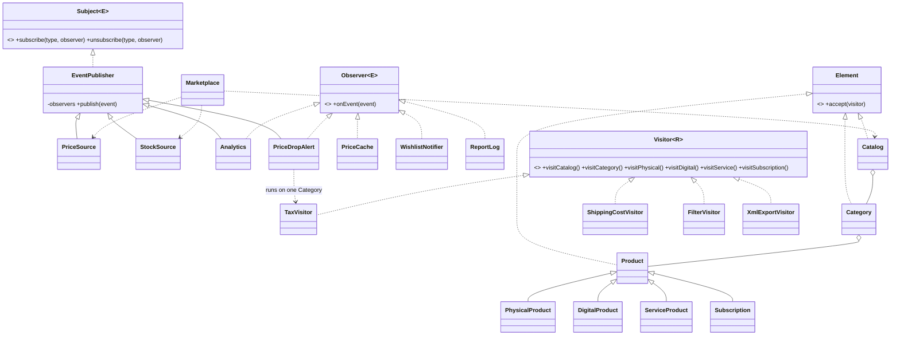

# Online Marketplace: Observer + Visitor (Variant 4)

Java 17, JUnit 5, no other libraries. Run tests: `mvn test`. Run demo: `mvn compile && java -cp target/classes marketplace.Marketplace`.

## What it does
Two feeds (`PriceSource`, `StockSource`) publish events. Five listeners react. A stable catalog tree
(`Catalog -> Category -> 4 product types`) is processed by visitors. A price drop starts a visitor on the
affected category only, and the result comes back as a new event.

```
PriceSource ──PRICE_CHANGED──> PriceCache, Analytics, PriceDropAlert
StockSource ──STOCK_CHANGED──> PriceCache, Analytics, WishlistNotifier
Analytics ───STATS_UPDATED───> ReportLog                      (observer chain)
PriceDropAlert ─(TaxVisitor on one Category)─CATEGORY_REPORT─> ReportLog   (integration)
```

## Design decisions
- **Push model.** The event carries `id`, `oldValue`, `newValue`. A listener needs no call back to the source, and it
  cannot read a value that another thread has already changed (pull would have this race).
- **Immutable events.** `MarketEvent` is a record, so it can be shared between threads safely.
- **Subscribe per type, join/leave at runtime.** `EventPublisher` keeps one `CopyOnWriteArrayList` per `EventType`
  in a `ConcurrentHashMap`. `publish` walks a snapshot, so a listener can unsubscribe inside its own handler
  (`WishlistNotifier` does) and other threads can subscribe at the same time. No lock on the whole subject.
- **Observer chain.** `Analytics` is a listener and a subject: it counts events and republishes `STATS_UPDATED` every 100.
- **Traversal is done by the visitor, not by the tree.** Elements are data + `accept`. Each visitor decides how to
  combine children (sum, collect a list, build nested XML) and what `R` it returns.
- **Double dispatch.** `element.accept(visitor)` calls `visitor.visitXxx(this)`, so the compiler picks the method by
  the element type and the visitor type; there is no `instanceof`.
- **Integration.** `PriceDropAlert` gets a `Map<product id, Category>` and runs `TaxVisitor` on that one category only.
- **Concurrency.** `Marketplace.run` starts `threads` producers on a fixed `ExecutorService`, then `shutdown()` +
  `awaitTermination()` (and `shutdownNow()` only on timeout). Events are delivered inside the producer thread, so when
  the pool terminates, no event is lost. Shared state: `AtomicLong`, `AtomicBoolean`, `ConcurrentHashMap`,
  `ConcurrentLinkedQueue`, `CopyOnWriteArrayList`. `Product.replacePrice` is `synchronized` (per product).
- **Clean Code.** `Marketplace` is the only composition root; all dependencies come through constructors;
  no lazy initialization; no `Observable`, no libraries.

## UML



## Visitors
| Visitor | Kind | Result |
|---|---|---|
| `TaxVisitor` | numeric | tax of a subtree: physical 12%, digital 10%, service 5%, subscription 10% |
| `ShippingCostVisitor` | accumulates state | sum of weight * 3.0 over physical products |
| `FilterVisitor` | filter | list of products that match a `Predicate` |
| `XmlExportVisitor` | export | hand-written nested XML |

## Trade-off proof (two separate commits, patches in `tradeoff/`)
**Commit 1: new visitor** (`git apply tradeoff/01-new-visitor.patch`)
- New: `TotalPriceVisitor.java`, `TotalPriceVisitorTest.java`
- Changed element classes: **0**. Cost: one new class. Visitor is cheap when a new *operation* is needed.

**Commit 2: new element type `GiftCard`** (`git apply tradeoff/02-new-element.patch`)
- New: `GiftCard.java`
- Changed: `Visitor.java` (+ `visitGiftCard`), `TaxVisitor`, `ShippingCostVisitor`, `FilterVisitor`,
  `XmlExportVisitor`, `TotalPriceVisitor` (each + one method)
- Total: 1 new + 6 changed files. Cost: every visitor must be edited (the compiler forces it), and it grows with the
  number of visitors. If new element types appear often, Visitor is the wrong pattern; it fits a stable tree with
  growing operations.

## Tests
21 JUnit 5 tests (+1 after commit 1): events and listeners, visitor results against hand-calculated values
(tax 191.0, shipping 7.5, ...), integration reports, a stress test (4 threads x 1000 events = exactly 4000 events,
40 stats updates) and a test that `WishlistNotifier` fires exactly once when 4 threads publish together.
